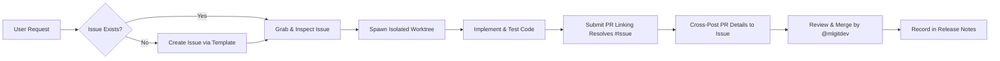

# Issue Management Skill (`issue`)

This skill defines the mandatory **Issue-First Protocol** for NewsAlerts. All AI agents, contributors, and developers must follow this protocol for every user request, bug fix, feature addition, refactoring, or documentation update.

---

## 1. The Issue-First Golden Rule

> [!IMPORTANT]
> **No Work Without an Issue**: Never create a worktree, branch, or write code without an active, correlated GitHub Issue.
> If the user asks for a feature, bug fix, or improvement, **audit existing issues first**; if no issue exists, **create one immediately** before starting development.

### Core Lifecycle Flow:


---

## 2. Searching, Auditing & Grabbing Issues

Before taking action, inspect the repository issues using the GitHub CLI (`gh`):

### 1. List Open Issues:
```bash
# List all open issues
gh issue list --state open

# Filter by label (bug, enhancement, task)
gh issue list --label "enhancement"
gh issue list --label "bug"

# Search for specific keywords
gh issue list --search "screener in:title"
```

### 2. View Issue Details:
```bash
# View full issue body, labels, and comments
gh issue view <issue-number>

# View JSON output for script parsing
gh issue view <issue-number> --json number,title,body,labels,assignees
```

### 3. Assign & Mark In-Progress:
```bash
# Assign the issue and label it as in-progress
gh issue edit <issue-number> --add-assignee "@me" --add-label "in-progress"
```

---

## 3. Creating Issues for New Requests (Issue-First)

If no issue exists for a user prompt, create one using the standardized template structure:

### 1. Select Template Type:
- **`feat:`** (`.github/ISSUE_TEMPLATE/feature_request.md`): New features, strategies, or terminal controls.
- **`fix:`** (`.github/ISSUE_TEMPLATE/bug_report.md`): Defects, regressions, or incorrect data.
- **`task:`** (`.github/ISSUE_TEMPLATE/task.md`): Refactoring, testing, documentation, or CI/CD enhancements.

### 2. Create Issue via CLI:
```bash
# Create feature issue
gh issue create \
  --title "feat(news): add real-time watchlist ticker search" \
  --body-file "scratch/issue_body.md" \
  --label "enhancement" \
  --assignee "mlgitdev"

# Create bug report issue
gh issue create \
  --title "fix(tape): correct 5-minute relative volume calculation" \
  --body-file "scratch/bug_body.md" \
  --label "bug" \
  --assignee "mlgitdev"
```

> [!TIP]
> Always verify that your issue body contains the required template headings (`### Description`, `### Steps to Reproduce`, or `### Proposed Solution`), or the automated `issue-validator` bot will flag it as `incomplete-template`.

---

## 4. Branch & Worktree Naming Correlation

Always correlate the branch and worktree name directly with the issue number:

```powershell
# Windows PowerShell
.\build.ps1 -Task worktree-new -Branch feat/<descriptor>-<issue-number> -Base main
```
```bash
# Linux / macOS
./scripts/worktree.sh new feat/<descriptor>-<issue-number> main
```

**Examples:**
- `feat/custom-news-search-28`
- `fix/tape-monotonic-surge-29`
- `task/issue-automation-skill-30`

---

## 5. Pull Request Correlation (`Resolves #X`)

When authoring the Pull Request:
1. **Title**: Must be Conventional Commits format matching the issue scope.
2. **Body**: In the `## Summary` and `## Changes` sections, include the closing keyword:
   - `Resolves #<issue-number>` (or `Closes #<issue-number>`, `Fixes #<issue-number>`).
   - GitHub will automatically link the PR to the issue and close the issue upon merge into `main`.

**Example PR Body Snippet:**
```markdown
## Summary
Implements on-demand US equity symbol search and interactive watchlist chips in the news wire pane. Resolves #28.
```

---

## 6. Cross-Posting Resolution Details to the Issue

To maintain complete transparency and institutional auditing, **always post a cross-reference comment to the issue** immediately after creating the PR:

```bash
gh issue comment <issue-number> --body "### 🚀 Resolution In Progress
A solution for this issue has been implemented and submitted in Pull Request #<pr-number>.

- **Branch**: \`feat/<descriptor>-<issue-number>\`
- **PR URL**: https://github.com/mlgitdev/NewsAlerts/pull/<pr-number>
- **Summary of Changes**:
  - Implemented ...
  - Added unit tests in \`tests/...\`
  - Verified local verification gate (compile, tests, package audit).

*The issue will automatically close upon PR merge into \`main\`.*"
```

---

## 7. Release Correlation Protocol

When a SemVer release is cut (`docs/releases/vX.Y.Z.md` and `docs/RELEASES.md`):
1. Every resolved issue from merged PRs must be cataloged under `### 🎯 Closed Issues`.
2. Format: `- Resolves #<number>: <concise description> ([#<pr-number>](https://github.com/mlgitdev/NewsAlerts/pull/<pr-number>))`
3. This creates a permanent, bidirectional audit trail from release notes &rarr; PR &rarr; Issue.

---

## 8. Inactivity Reminders & Stale Lifecycle

All issues are automatically monitored by the `.github/workflows/stale-issues.yml` bot:
- **7 Days Inactivity**: Receives an automated reminder comment and `reminder-sent` label.
- **30 Days Inactivity**: Marked with the `stale` label.
- **37 Days Inactivity (7 Days Post-Stale)**: Closed automatically if no updates or comments are posted.
- **Exemptions**: Issues with `pinned`, `security`, or `in-progress` labels are protected from stale closures.
