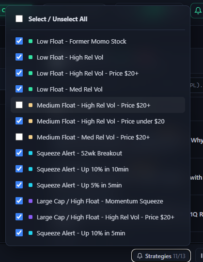
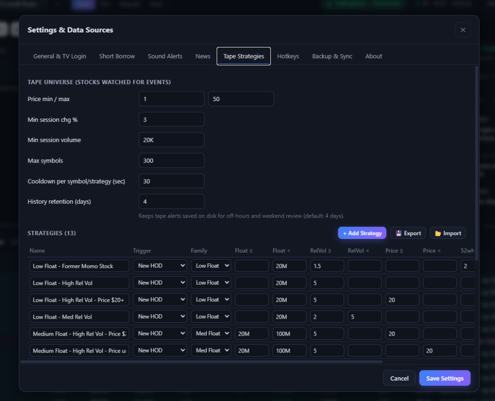
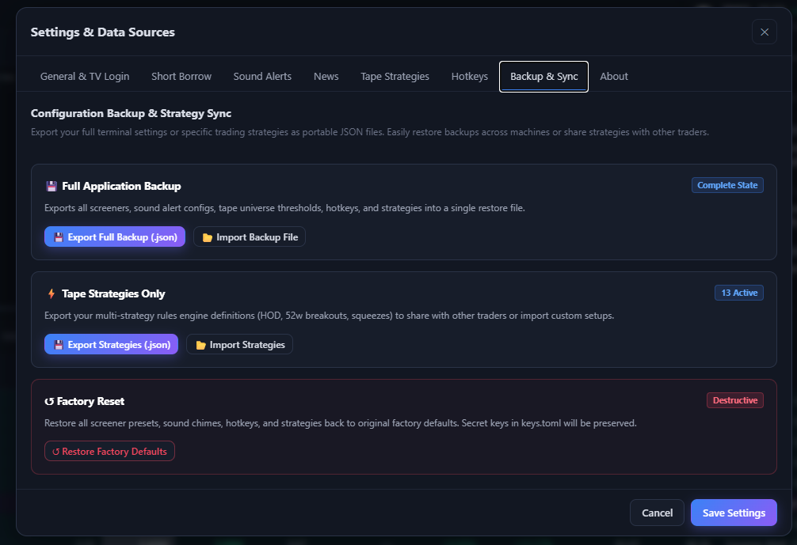

# Configuration Guide

NewsAlerts provides extensive customization options via the **In-App Settings Modal** or via `<APP_DIR>/keys.toml` (Windows `%APPDATA%\NewsAlerts\`, macOS `~/Library/Application Support/NewsAlerts/`, Linux `~/.config/NewsAlerts/` or `$HOME/.newsalerts`). Custom data directories can also be set via the `NEWSALERTS_DIR` or `NEWSALERTS_HOME` environment variables.

---

## 1. TradingView Real-Time Data

By default, TradingView provides 15-minute delayed market data. Subscribers of TradingView Pro / Premium can enable real-time data by supplying their session cookie:

1. Open [TradingView](https://www.tradingview.com) in Chrome, Edge, or Brave.
2. Press `F12` to open Developer Tools → Navigate to **Application** → **Cookies** → `https://www.tradingview.com`.
3. Copy the value of the `sessionid` cookie (and optionally `sessionid_sign`).
4. In NewsAlerts, click the **TradingView Status Pill** in the top-right corner (or open Settings → **General & TV Login**).
5. Paste your `sessionid` and click **Save Settings**.
6. The status pill will immediately switch to 🟢 `[▲ TradingView — Connected]`.

---

## 2. Short Borrow Locates (Alpaca Integration)

To see real-time short borrow indicators (`ETB`, `HTB`, `NO BORROW`):
1. In Settings, open the **Short Borrow** tab.
2. Enter your Alpaca **API Key ID** and **Secret Key** (Paper or Live account keys).
3. Select Locate Mode:
   - `Auto (Alpaca + Fallback Heuristics)` — queries Alpaca with fallback to float/exchange thresholds.
   - `Alpaca Only` — strict API lookup.
   - `Heuristics Only` — estimate based on market float (<15M = HTB, <5M = NO BORROW).
4. Click **▶ Test Alpaca Connection** to verify your account status.

---

## 3. Telegram Bot Push Alerts

Receive instant push notifications on your phone or desktop when a runner pops up:
1. Talk to `@BotFather` on Telegram to create a bot and get your **Bot Token**.
2. Start your bot and message `@userinfobot` to get your numerical **Chat ID**.
3. In NewsAlerts, open Settings → **Sound Alerts**.
4. Enter your Bot Token and Chat ID.
5. Click **✈️ Send Test Message** to verify delivery.
6. Toggle **Tape Momentum Alerts** and customize the per-symbol cooldown (default: 60s).

---

## 4. Tape Strategies & Quick-Filter Popout

The Tape monitors the momentum universe (configurable: Price $1–$500, Min Change 1%, up to 400 symbols) and evaluates real-time momentum strategies:
- **Low Float – Former Momo Stock**: Float < 20M, RelVol ≥ 1.5, 52w high ratio ≥ 2.0.
- **Low Float – High Rel Vol**: Float < 20M, RelVol ≥ 5.0.
- **Low Float – High Rel Vol – Price $20+**: Float < 20M, RelVol ≥ 5.0, Price ≥ $20.
- **Low Float – Med Rel Vol**: Float < 20M, 2.0 ≤ RelVol < 5.0.
- **Medium Float – High Rel Vol – Price $20+**: 20M ≤ Float < 100M, RelVol ≥ 5.0, Price ≥ $20.
- **Medium Float – High Rel Vol – Price under $20**: 20M ≤ Float < 100M, RelVol ≥ 5.0, Price < $20.
- **Medium Float – Med Rel Vol – Price $20+**: 20M ≤ Float < 100M, 2.0 ≤ RelVol < 5.0, Price ≥ $20.
- **Large Cap / High Float – Momentum Squeeze**: Float ≥ 100M, 5% gain in 5 minutes (monitors runners like SMCI, NVDA, TSLA).
- **Large Cap / High Float – High Rel Vol – Price $20+**: Float ≥ 100M, RelVol ≥ 2.0, Price ≥ $20.
- **Squeeze Alert – 52wk Breakout**: New 52-week high breakout.
- **Squeeze Alert – Up 10% in 5min**: 10% gain in 5 minutes (high-velocity breakout).
- **Squeeze Alert – Up 10% in 10min**: 10% gain in 10 minutes (up-only within active window).
- **Squeeze Alert – Up 5% in 5min**: 5% gain in 5 minutes (up-only within active window).

### Quick-Filter Popout (Tape Header)
Active traders do not need to open Settings to adjust strategies during fast sessions. Clicking the `🔔 Strategies [N/M]` button directly in the running tape header launches a floating quick-toggle menu:

<p align="center">
  <a href="img/tape_strategies_menu.png">
    
  </a>
  <br>
  <small><em>Tape header quick-toggle dropdown: One-click strategy toggles with matching color bullets and master select/unselect.</em></small>
</p>

- **Select / Unselect All**: Instant master checkbox to enable or disable all strategy streams with one click.
- **Color Bullet Indicators**: Colored markers correlate directly with tape highlight rows (mint for Low Float, sand for Med Float, violet for Large Cap, cyan for Squeeze).
- **Live Active Counter**: Header badge updates dynamically (e.g. `Strategies 11/13`) showing active rule filters.

---

## 5. Keyboard Shortcuts & Hotkeys Configuration

NewsAlerts includes a dedicated **Hotkeys** tab in Settings to customize keyboard shortcuts to user preferences:
- **Interactive Rebinding**: Click any shortcut input in the Hotkeys tab and press the desired key to rebind it immediately.
- **Restore Defaults**: Click **↺ Reset Defaults** to restore institutional trading defaults anytime.
- **Configuration Schema (`config.json`)**:
  ```json
  "hotkeys": {
    "mute": "m",
    "popout_tape": "t",
    "pause_tape": "Space",
    "settings": "s",
    "refresh": "r",
    "close_modal": "Escape",
    "focus_story": "Enter",
    "preset_1": "1",
    "preset_2": "2",
    "preset_3": "3",
    "preset_4": "4",
    "preset_5": "5"
  }
  ```
- **Focus Protection**: Shortcuts automatically yield when typing inside text boxes or search inputs to prevent accidental triggers.

---

## 6. Interactive Strategy Builder (Settings)

NewsAlerts provides an interactive Strategy Builder inside Settings → **Tape Strategies**:

<p align="center">
  <a href="img/strategy_builder.png">
    
  </a>
  <br>
  <small><em>Settings → Tape Strategies: Rule definition table, trigger selectors, family tags, inline export/import, and universe thresholds.</em></small>
</p>

- **Add Custom Strategy (`+ Add Strategy`)**: Click to append a new custom strategy row.
- **Trigger Type**:
  - `New HOD`: Fires when a matching stock prints a new session high.
  - `52w Breakout`: Fires when the price crosses above the 52-week high.
  - `Up X% in N min`: Momentum squeeze monitoring percent gain over a rolling time window.
- **Family Classification**: Set strategy family to `Low Float`, `Med Float`, `Large Cap`, `Squeeze`, or `Custom`.
- **Delete Strategy (`🗑️`)**: Click the trash icon to delete any strategy. Deletions are remembered in `deleted_strategies` so factory defaults do not resurrect upon reboot.
- **Rapid Preset Export/Import**: Use the inline `💾 Export` and `📂 Import` buttons directly above the table to share strategy presets.

---

## 7. Backup / Import & Export Sync Center

The **Backup & Sync** tab in Settings allows full disaster recovery, strategy sharing, and clean state resets:

<p align="center">
  <a href="img/backup_sync.png">
    
  </a>
  <br>
  <small><em>Settings → Backup & Sync: Full application backup, strategy definition sync, and destructive factory reset.</em></small>
</p>

- **Full Application Backup (`Complete State`)**:
  - `💾 Export Full Backup (.json)`: Saves complete terminal state (`screeners`, `alerts`, `hotkeys`, `news`, `tape`).
  - `📂 Import Backup File`: Validates and restores complete configuration with immediate UI live-reload.
- **Tape Strategies Only Sync (`N Active`)**:
  - `💾 Export Strategies (.json)`: Saves only the `strategies` and `enabled` arrays.
  - `📂 Import Strategies`: Merges or updates strategies into the active running tape.
- **Factory Defaults Reset (`Destructive`)**:
  - `↺ Restore Factory Defaults`: Reverts configuration to factory baseline while securely preserving `keys.toml`.

---

## 8. Transparent Secrets Storage & Management Architecture

NewsAlerts enforces clean environment separation and complete transparency for user credentials:

| Operating System | Central Application Directory (`APP_DIR`) | Fallback Location |
| :--- | :--- | :--- |
| **Windows** | `%APPDATA%\NewsAlerts\` (`C:\Users\<user>\AppData\Roaming\NewsAlerts\`) | `$HOME/.newsalerts\` |
| **macOS** | `~/Library/Application Support/NewsAlerts/` | `$HOME/.newsalerts/` |
| **Linux / BSD** | `$XDG_CONFIG_HOME/NewsAlerts/` (default `~/.config/NewsAlerts/`) | `$HOME/.newsalerts/` |

### Direct In-App Inspection:
In **Settings (`S`) &rarr; About** and **Settings &rarr; Backup & Sync**, the terminal displays the active resolved directory path alongside an interactive **📂 Open Folder** button that launches Windows Explorer, macOS Finder, or the Linux file manager.

### Where Credentials Live:
1. **Unified Storage (`config.json`)**:
   By default, credentials entered through the Settings dialog are stored in `<APP_DIR>/config.json` under `"tv"` (cookies), `"borrow"` (Alpaca keys), and `"alerts"` (Telegram bot tokens). All fields are password-masked in the UI and written atomically via temporary file replacement.
2. **Dedicated Standalone Secrets (`keys.toml`)**:
   Users who prefer separating private credentials from UI configurations can place a `keys.toml` file in `<APP_DIR>/keys.toml`. When present, values in `keys.toml` override those in `config.json`.
3. **In-Flight Validation**:
   - TradingView: Live header badge reflects authenticated session status.
   - Alpaca: **▶ Test Alpaca Connection** checks account buying power and active status.
   - Telegram: **✈️ Send Test Message** dispatches an instant probe ping to the configured chat.

---

## 9. Broker Closing-Only & Banned Stock Filter

For day traders using Interactive Brokers (IBKR) or other brokerages, certain volatile micro-caps or penny stocks (e.g. `YMAT` on `NASDAQ.SCM`) may be placed into "closing-only" or margin-restricted status by broker risk management desks, blocking new buy orders.

NewsAlerts provides an integrated filtering and blacklisting engine:
1. **Top Banner Toggle Switch (`[🚫 Banned: ON / OFF]`)**:
   - Toggles filtering across both the **Screener grid** and the **Tape momentum stream**.
   - Suppresses audio chimes and Telegram alerts for blacklisted symbols when active.
2. **1-Click 🚫 Symbol Blacklist**:
   - Click the `🚫` icon button next to any symbol in the Screener, Tape, or News header to ban it immediately.
3. **Settings Banned Stocks Manager (`Settings → 🚫 Banned Stocks`)**:
   - View, add, or remove banned tickers (`config.json` &rarr; `banned_symbols`).
   - Add tickers manually using the `+ Add Symbol` input.

