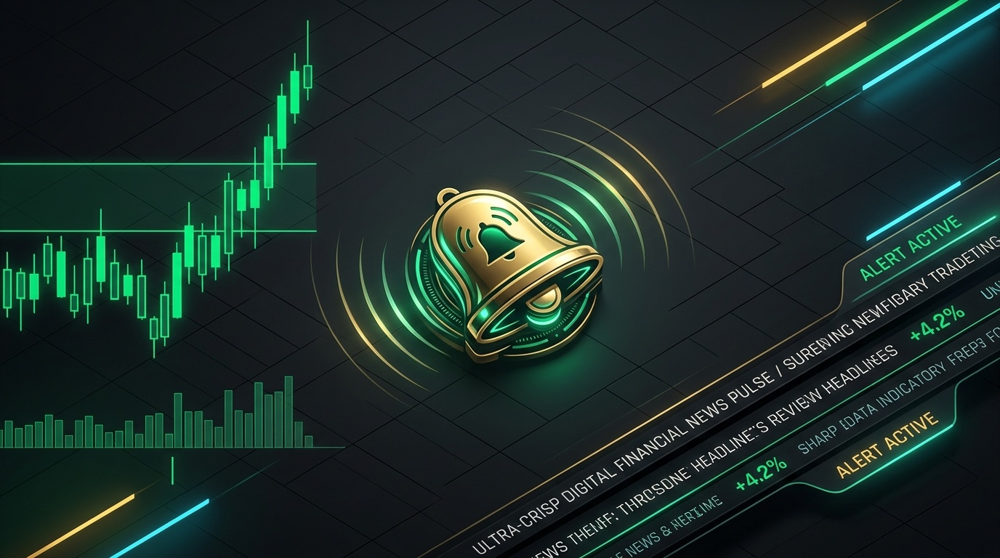
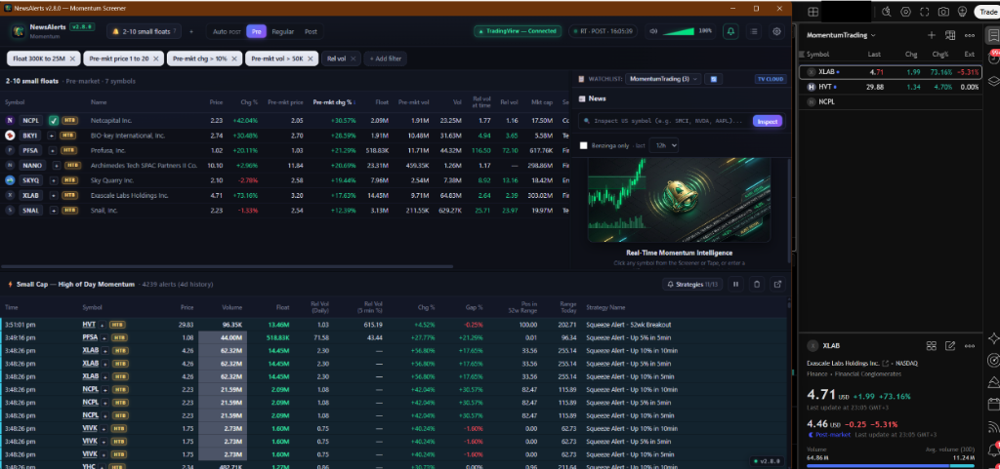

# NewsAlerts — Momentum Screener, Tape & News (Windows desktop)

<p align="center">
  
</p>

## 1. Goal
A lightweight Windows desktop app that replicates the TradingView stock screener workflow
(small-float momentum), and adds what TradingView lacks:

1. **A bell** when a new symbol enters the screener table.
2. **Zero-lag news wire** (Benzinga-first) showing *immediate* breaking headlines (eliminating the typical 5–15 minute delay seen on standard charting platforms).
3. **A running tape** (Warrior-Trading style "Small Cap – High of Day Momentum") driven by
   predefined, toggleable strategies.

## 2. Tech stack
| Layer | Choice | Why |
|---|---|---|
| Backend | Python 3.11 (native Windows, no container) | Already installed, simple |
| Window | `pywebview` (WebView2 / Edge) | Native window, ~no footprint, no Node/Electron |
| Frontend | Vanilla HTML/CSS/JS | No build step |
| HTTP | `requests` | Scanner + news calls |
| Sounds | `winsound` + `C:\Windows\Media\*.wav` | Native Windows sounds, zero deps |
| Time | `zoneinfo` + `tzdata` | Session detection in America/New_York |
| Config | JSON in `<APP_DIR>/config.json` | Cross-platform persistence (Windows `%APPDATA%`, macOS `Application Support`, Linux `$XDG_CONFIG_HOME` or `$HOME/.newsalerts`) |

Run: `run.bat` → creates venv on first run → `python -m app.main`.

## 3. Data sources
### 3.1 Screener — TradingView scanner (US Market Only)
- `POST https://scanner.tradingview.com/america/scan` (the endpoint the TV web screener uses).
- **US Only**: Hard-filtered to US common equities:
  `country = "United States"`, `type = "stock"`, `exchange in ["AMEX", "NASDAQ", "NYSE"]`, `is_primary = true`.
  Excludes ADRs, foreign shares, OTC, and funds.
- Auth: user pastes `sessionid` (+ optional `sessionid_sign`) cookie from tradingview.com in
  Settings → real-time data for subscribers. Without it data is 15-min delayed.
- **TradingView Connection Status Badge**: Positioned in the main window top-right corner directly to the left of the session & market status pill:
  - `[▲ TradingView — Connected]` (🟢 **Green**): Session cookies are active and verified against TradingView; displays verified username and subscription tier on hover.
  - `[▲ TradingView — Disconnected]` (🔴 **Red**): Session cookies are missing, invalid, or expired. Clicking opens Settings directly to the TradingView credentials tab.
- The app reads the `update_mode` field and shows a **REALTIME / DELAYED** badge in the status bar.
- Default poll interval: **3 s** (configurable 1–30 s). Backoff on HTTP 429/5xx.

### 3.2 News — TradingView news feed (includes Benzinga)
- Headlines: `GET https://news-headlines.tradingview.com/v2/headlines?symbol=EXCH:TICKER&lang=en`
- Story body: `GET https://news-headlines.tradingview.com/v2/story?id=<id>&lang=en`
  (AST → rendered HTML in-app; "Open in browser" button for the original link).
- Provider filter: **Benzinga only** / All providers (default: All, Benzinga highlighted).
- Recency filter: default **last 12 h** (options: 1 h, 2 h, 4 h, 8 h, 12 h, 24 h, 3 d, 7 d). Designed for weekend and off-hours review where catalyst news broke 2–7 days prior.
- Pluggable `NewsProvider` interface so an official Benzinga API key can be added later.

### 3.3 Short Borrow Availability Indicator (Easy / Hard / No Borrow / NA)
Displays a color-coded status badge directly next to each symbol in both the Screener and the Tape:
- **Easy to Borrow (ETB)**: 🔴 **Red** (`easy is read`) — Easy for shorters to dump / high supply
- **Hard to Borrow (HTB)**: 🟡 **Yellow** (`hard yellow`) — Limited supply / locate fee required
- **No Borrow Available**: 🟢 **Green** (`no borrow is green`) — No shares available to short / highest squeeze potential
- **N/A / Unknown**: 🟠 **Orange** (`na data orange`) — Data unavailable or symbol unlisted for locate
- **Data Source**: Integrated with Alpaca Broker API (free paper account keys in Settings / secrets) for real-time broker locates (`borrow_status: hard_to_borrow` -> HTB Yellow, `easy_to_borrow` -> ETB Red), with an intelligent float-based heuristic fallback (float < 500K = No Borrow, 500K–50M = HTB, > 50M = ETB).

### 3.4 TradingView Cloud Watchlist Integration & 1-Click Quick-Add
Seamless cloud watchlist synchronization with user TradingView accounts:

<p align="center">
  
  <br>
  <small><em>Live Watchlist Synchronization (v2.8.0): Clicking the <code>+</code> button next to NCPL triggers a 3-second green flickering glow (<code>✓</code>) and instantly appends the symbol to the active TradingView cloud watchlist (shown live in TradingView Desktop on the right).</em></small>
</p>

- **Watchlist Selector Bar**:
  - Located directly above the News pane (`#news-pane`) for rapid watchlist switching during active trading.
  - Dropdown populated with user TradingView cloud watchlists (`https://www.tradingview.com/api/v1/symbols_list/custom/`), displaying list title and symbol counts.
  - Sync button (`🔄`) to refresh remote lists on demand without restarting the terminal.
  - Live status badge indicating cloud connection (`TV Cloud`) or local fallback mode (`Local`).
- **1-Click Quick-Add (`+`) Buttons**:
  - Positioned adjacent to stock symbols in:
    1. Screener table (symbol column)
    2. Momentum Tape rows (symbol column)
    3. News pane header (inspected symbol)
  - Automatic exchange qualification: bare tickers (e.g. `SMCI`) are resolved to institutional `EXCHANGE:TICKER` standard (e.g. `NASDAQ:SMCI`) prior to submission.
- **Visual Feedback & Error Feedback**:
  - **Success / Already in Watchlist**: Silent green flickering glow animation (`flicker-green`) on the `+` button for 3 seconds, transforming into `✓`. No disruptive alert or modal popup.
  - **Failure (e.g. session expired, network failure)**: Red flickering glow animation (`flicker-red`) on the `+` button for 3 seconds, transforming into `✕`, paired with an error toast notification.
  - **Offline / Local Fallback**: When unauthenticated, symbols are saved to the persistent local `config.json` watchlist (`local_default`).

## 4. Market sessions
Session selector: **Auto | Pre-market | Regular | Post-market** (Auto uses ET clock:
Pre 04:00–09:30, Regular 09:30–16:00, Post 16:00–20:00, otherwise "Closed" → last session).

Every session-aware filter/column maps to a different TradingView field:

| Logical field | Pre-market | Regular | Post-market |
|---|---|---|---|
| Price | `premarket_close` | `close` | `postmarket_close` |
| Chg % | `premarket_change` | `change` | `postmarket_change` |
| Volume | `premarket_volume` | `volume` | `postmarket_volume` |
| Chg from open % | `premarket_change_from_open` | `change_from_open` | `postmarket_change` |
| Gap % | `premarket_gap` | `gap` | `gap` |
| High | `premarket_high` | `high` | `postmarket_high` |

Non-session fields: `float_shares_outstanding`, `market_cap_basic`, `sector`,
`relative_volume_10d_calc` (Rel vol), `relative_volume_intraday|5` (Rel vol at time),
`price_52_week_high/low`, `change|5`, `change|15`, `average_volume_10d_calc`.

## 5. Window layout
```
┌──────────────────────────────────────────────────────────────────────────┐
│ [Screen tabs: 2-10 small floats ▾ | + ]   Session [Auto▾]  🔔  ⚙  ● RT  │
│ Filter chips: [Float 300K–25M ×] [Price 1–20 ×] [Chg% >10 ×] [Vol >50K ×]│
│              [Rel vol ≥ … ×] [+ add filter]                               │
├───────────────────────────────────────────────┬──────────────────────────┤
│ SCREENER TABLE                                │ [📋 Watchlist: Momentum (24)▾ 🔄] [TV Cloud]
│ Sym | Name | Price | Chg% | S.Price | S.Chg% |│ NEWS  (SMCI 37.55 [+] ETB ⧉)
│ Float | S.Vol | Vol | RelVol@t | RelVol |     │ [🔍 Inspect US symbol... ]
│ MktCap | Sector | 📰 | First seen             │ [Benzinga only · last 12h]
│ [SMCI +] [NVDA +] [AAPL +]                    │ • 19:11 Super Micro AI...
├───────────────────────────────────────────────┴──────────────────────────┤
│ TAPE — Small Cap High of Day Momentum   [🔔 Strategies 11/13] [⏸] [🗑] [⧉]│
│ Time | Sym | Price | Vol | Float | RelVol | RelVol5m% | Chg% | Gap |...   │
│ 19:15 [SMCI +] 37.55  2.1M  12.4M   4.5x ...                             │
└──────────────────────────────────────────────────────────────────────────┘
```
- Panes are resizable (drag splitters); sizes persisted.
- Watchlist Selector Bar (`#watchlist-bar`) positioned directly above the News pane.
- News pane features custom US equity symbol inspection (`#news-sym-input`) and quick watchlist chips.
- Tape header features instant quick-filter popout (`Strategies 11/13`) with color bullets and select/unselect all.
- Tape can pop out into its own window (second pywebview window).
- Dark theme matching TradingView look.

## 6. Screener
### 6.1 Screens (presets)
- Multiple named screens (tabs); each has its own filters, sort, session, columns and alert settings.
- Shipped default: **"2-10 small floats"** = Float 300K–25M, Price 1–20, Chg% > 10, Vol > 50K
  (session-aware). Rename / duplicate / delete supported.

### 6.2 Filters (all editable)
Each filter is a chip; click to edit min/max, × to remove, "+" to add.

| Filter | Type | Session-aware |
|---|---|---|
| Price | range | ✓ |
| Chg % | range | ✓ |
| Volume | range | ✓ |
| Chg from open % | range | ✓ |
| Gap % | range | ✓ |
| Float | range | |
| Market cap | range | |
| Rel vol | range (always visible, quick edit) | |
| Rel vol at time | range | |
| Sector | multi-select | |
| Exchange | multi-select (NASDAQ/NYSE/AMEX), OTC excluded by default | |

Values accept suffixes `K`, `M`, `B` (e.g. `300K`, `25M`).

### 6.3 Columns (default order)
Symbol · Name · Price · Chg % · *Session* price · *Session* chg % · Float · *Session* vol · Vol ·
Rel vol at time · Rel vol · Mkt cap · Sector · 📰 (recent-news flag) · First seen.

In Regular session the "Session" columns are hidden (they duplicate Price/Chg/Vol).
Click header to sort; sort persisted per screen. Positive values green, negative red.

### 6.4 New-symbol alert (the bell)
- Each poll diffs the symbol set against the previous poll.
- **New symbol** = not in table in the last *N* minutes (re-entry window, default 15 min).
- On new symbol: play selected sound, row flashes (yellow pulse 3 s), "NEW" badge for 60 s,
  window title shows count, entry added to an alert log.
- First load of a screen (or after filter edits) does **not** alert (seeds silently).
- Per-screen 🔔 toggle; global mute; quiet when the window is focused (optional).
- Background fetch of headlines for new symbols → 📰 flag if news within recency window.
  Optional separate sound for "new symbol has fresh news".

### 6.5 Click → news
Clicking a row selects it and loads news in the right pane (§7).

## 7. News pane
- Header: symbol, name, price/chg, borrow locate status, description, float, bid/ask spread, session VWAP, and TradingView chart button.
- **Custom Symbol Search & Watchlist**:
  - Sticky institutional search bar at top of news pane supporting any US common equity ticker (e.g. `SMCI`, `AAPL`, `NVDA`, `NASDAQ:SMCI`).
  - Strict US market scoping (AMEX, NASDAQ, NYSE common stocks).
  - Pinned quick-access chips (`[ SMCI × ] [ NVDA × ] [ AAPL × ]`) for rapid watchlist switching and removal.
- List of headlines within recency window, newest first: time (ET, + "12m ago"), provider badge
  (Benzinga highlighted orange), title.
- Click headline → expands inline story text; "Open" opens original URL in default browser.
- Auto-refresh every 30 s while symbol selected; new headline → subtle highlight (+ optional sound).
- Empty state: Hero graphic with immediate guidance to select from Screener, Tape, or enter a custom US symbol.

## 8. Tape (running momentum events)
### 8.1 Universe & engine
- Separate scanner query (every 2 s): US stocks, price 1–50, session chg% > 3, session vol > 20K,
  top 300 by chg%. (Editable in Settings.)
- Engine keeps a rolling in-memory history per symbol: `(ts, price, volume, high)` for 30 min.
- **Event** = a symbol matching ≥1 enabled strategy AND one of:
  - makes a **new high of day** (session-aware high) vs the previous poll, or
  - triggers a squeeze condition (§8.2), with per-symbol/per-strategy cooldown (default 30 s). **Monotonic Window Progression**: During an active time window (e.g. 5 min / 10 min), subsequent triggers for the same symbol & strategy require strictly higher prices (`price > last_alert_price`). If the price falls or is flat vs the previous trigger, alerts are suppressed; once the time window resets (`now - last_alert_time >= window_min * 60`), a new squeeze cycle can begin.
- **Persistent Storage & Off-Hours Review**: Tape alerts are automatically saved to `%APPDATA%\NewsAlerts\tape_history.json` and retained for at least 4 days (configurable). When the app restarts, reloads, or opens during off-hours / weekends, all historical alerts are immediately loaded into the tape for retrospective review.
- **Timestamp Formatting**: Displays `H:MM:SS am/pm` for alerts triggered today, and `MMM DD H:MM am/pm` for older alerts, with full ET date/time and relative age tooltips.
- Newest events on top; up to 3,000 scrollable rows; ⏸ pause freezes scrolling and shows "New events ↑"; 🗑️ clear button removes history.

### 8.2 Predefined strategies (toggle list like the Warrior screenshot)
| Strategy | Rule (defaults, all editable in Settings) |
|---|---|
| Low Float – Former Momo Stock | float < 20M, 52w high ≥ 2× price, rel vol ≥ 1.5 |
| Low Float – High Rel Vol | float < 20M, rel vol ≥ 5 |
| Low Float – High Rel Vol – Price $20+ | float < 20M, rel vol ≥ 5, price ≥ 20 |
| Low Float – Med Rel Vol | float < 20M, 2 ≤ rel vol < 5 |
| Medium Float – High Rel Vol – Price $20+ | 20M ≤ float < 100M, rel vol ≥ 5, price ≥ 20 |
| Medium Float – High Rel Vol – Price under $20 | 20M ≤ float < 100M, rel vol ≥ 5, price < 20 |
| Medium Float – Med Rel Vol – Price $20+ | 20M ≤ float < 100M, 2 ≤ rel vol < 5, price ≥ 20 |
| Large Cap / High Float – Momentum Squeeze | float ≥ 100M, price ≥ 1.05 × lowest in 5 min or change\|5 ≥ 5% (monitors SMCI, NVDA, TSLA) |
| Large Cap / High Float – High Rel Vol – Price $20+ | float ≥ 100M, rel vol ≥ 2, price ≥ 20 |
| Squeeze Alert – 52wk Breakout | price ≥ 52w high (fires on cross) |
| Squeeze Alert – Up 10% in 5min | price ≥ 1.10 × lowest in 5 min or change\|5 ≥ 10% (high-velocity spike) |
| Squeeze Alert – Up 10% in 10min | price ≥ 1.10 × lowest price in last 10 min (up-only within active 10m window) |
| Squeeze Alert – Up 5% in 5min | price ≥ 1.05 × lowest price in last 5 min (up-only within active 5m window) |

### 8.2.1 Tape Header Quick-Filter Popout
The tape header features an interactive `[🔔 Strategies N/M]` popout button allowing traders to filter active strategy streams directly from the running tape:
- **Floating Dropdown**: Opens right from the tape view without interrupting active screeners or charts.
- **Master Toggle**: `Select / Unselect All` checkbox enables or disables all strategies with a single click.
- **Color-Coded Bullet Indicators**: Color markers match tape print highlight families (mint = Low Float, sand = Med Float, violet = Large Cap, cyan = Squeeze).
- **Instant Reactive Filter**: Toggling any strategy immediately hides/shows matching historical rows and halts audio/Telegram alerts for disabled rules.

### 8.2.2 Interactive Strategy Builder (Settings)
Inside Settings → **Tape Strategies**, traders have access to the full Strategy Builder:
- **Add Custom Strategy (`+ Add Strategy`)**: Define custom Float bounds, RelVol thresholds, Price filters, and surge velocities.
- **Triggers**: Supports `New HOD`, `52w Breakout`, and `Up X% in N min`.
- **Family Badges**: Categorize rules into Low Float, Med Float, Large Cap, Squeeze, or Custom.
- **Deletions (`🗑️`)**: Deleted strategies are tracked in `deleted_strategies` in user configuration to prevent automatic resurrection.
- **Inline Import & Export**: Export presets (`💾 Export`) or import community strategies (`📂 Import`).

### 8.3 Tape columns
Time · Symbol (click → news) · Price · Volume · Float · Rel Vol (daily) · Rel Vol 5m % ·
Chg % · Gap % · Pos in 52w range % · Range today % · Strategy name.

### 8.4 Colors
Row background per strategy family (Low Float = mint, Medium Float = sand, Squeeze = cyan, Large Cap = violet/purple),
volume cell darker the larger the volume, float cell green when < 20M.
Optional tape sound (default off — the tape is noisy).

### 8.5 Telegram Push Alerts for Tape Momentum
- **Real-Time Push Notifications**: When momentum tickers print on the Tape (e.g. `NCPL` popping up on HOD / low-float runner), an instant Telegram push alert is dispatched to the user's configured chat.
- **Rich Message Format**: Includes Symbol, Strategy name, Session, Price, Change %, Volume, Float, Relative Volume (daily + 5m%), Short Borrow Status (`HTB` / `ETB` / `NO BORROW` / `N/A`), 52w range position, and a direct TradingView chart link.
- **Per-Symbol Cooldown**: A per-ticker cooldown (default 60s, configurable in Settings) prevents rapid duplicate push notifications when a runner repeatedly prints new HODs in seconds.

## 9. Sounds & Alert Controls
- **System Sounds**: Lists all `.wav` files in `C:\Windows\Media` (Windows Notify, Ding, chimes, Alarm01–10, etc.).
- **Separate Sound Pickers**: **New screener symbol**, **New news**, **Tape event**; ▶ test button each.
- **Async Throttled Playback**: Played async via `winsound.PlaySound(path, SND_FILENAME | SND_ASYNC)`; throttled to 1 per 1.5 s.
- **Alert Sound Volume Control**:
  - Interactive topbar widget featuring a speaker icon (high / low / mute), an interactive **visual rising triangle bar** filled from left to right with vibrant green (`#00e676`) representing current volume, and a percentage label (0% - 100%).
  - Clicking or dragging across the triangle instantly adjusts the volume.
  - Per-process waveform audio volume synchronized seamlessly via Windows WinMM `waveOutSetVolume` without external dependencies.
  - Clicking the speaker icon quickly toggles mute / restores prior volume level.
- **Unified Alert Pause (The Bell Button)**:
  - Single master toggle for active alerts vs. paused alerts.
  - Clicking the bell button **both mutes audio chimes AND suspends sending push notifications to Telegram** (for both Screener new symbols and Tape momentum alerts).
  - Visual status feedback: when active, shows normal green-tinted bell; when paused, shows slashed bell (`bellOff`) with pulsing red warning indicator.

## 10. Settings & Integrations
TradingView `sessionid`/`sessionid_sign` & real-time connection status · poll intervals · re-entry window · alert volume (0%–100%) · unified pause alerts toggle · news recency & provider · sounds · tape universe & strategy thresholds · interactive Strategy Builder (`+ Add Strategy`, triggers, family, deletion) · Backup / Import & Export tab (Full config backup `.json`, Strategies `.json` export/import, factory reset) · Alpaca keys for short borrow locates · Telegram Bot Token, Chat ID, and independent toggles for Screener alerts and Tape momentum alerts (with per-symbol cooldown) · customizable keyboard shortcuts & hotkeys with interactive re-binding and institutional defaults · always-on-top · font size.

## 11. Architecture
```
app/
  main.py        – starts pywebview windows, wires API + workers
  api.py         – JS↔Python bridge (pywebview js_api)
  config.py      – load/save %APPDATA%\NewsAlerts\config.json, defaults
  sessions.py    – ET clock, session detection, field mapping
  tv_client.py   – scanner + news HTTP client (cookie, retries, backoff)
  screener.py    – screen poller, query builder, diff / new-symbol detection
  tape.py        – tape universe poller, rolling history, strategy engine, telegram push
  news.py        – NewsProvider interface, TradingView provider, Alpaca provider, cache, AST→HTML
  borrow.py      – short borrow locate service (Alpaca + TV + heuristics fallback)
  telegram.py    – Telegram Bot API integration for Screener & Tape push notifications
  sounds.py      – list Windows sounds, throttled async playback
web/
  index.html, tape.html
  css/app.css
  js/app.js, screener.js, news.js, tape.js, settings.js, util.js
```
- Workers are daemon threads; they push updates to the UI with
  `window.evaluate_js("App.onScreener(<json>)")` etc.
- UI calls Python through `window.pywebview.api.*` (get/save config, select symbol, test sound…).

## 12. Dual Distribution Architecture & Release Packaging
NewsAlerts v2.9.0 introduces a **Dual Distribution Model** supporting both zero-install portable execution and high-performance per-user installation with near-instant startup.

### 12.1 Distribution Formats

| Format | Target Path | File Size | Cold Launch | Warm Launch | Best For |
|:---|:---|:---|:---|:---|:---|
| **Portable Executable** | Standalone `NewsAlerts.exe` | ~15.0 MB | ~1.8s – 2.4s | ~1.1s | Drop-in usage, USB drives, quick testing |
| **Unpacked App Directory** | `dist\NewsAlerts-App\` | ~29.6 MB | ~0.3s – 0.4s | **< 0.2s** | Active daily momentum trading, instant startup |
| **Windows Setup Installer** | `NewsAlerts-Setup-vX.Y.Z.exe` | ~13.5 MB | N/A (Installs App) | **< 0.2s** | Institutional desktop setup with shortcuts |

### 12.2 Performance Architecture & The Antivirus Tax
- **Portable Standalone (`--onefile`) Mechanism**:
  PyInstaller's bootloader extracts ~48 MB of loose runtime files (`python311.dll`, `.pyd` C-extensions, Win32/.NET assemblies, `web/` assets) into `%LOCALAPPDATA%\Temp\_MEIxxxxxx` on every launch. On Windows, writing new executable binaries into `%TEMP%` triggers real-time Windows Defender heuristic scans, adding 1.5–2.5 seconds of latency before the terminal window paints.
- **Unpacked Application Directory (`--onedir`) Mechanism**:
  Files reside permanently on disk in `_internal\`. Zero decompression occurs, Windows Defender already validated the files during install/download, and Windows OS File System Page Cache (`SysMain`) memory-maps the DLLs directly. Terminal startup drops to **sub-300ms**.

### 12.3 Windows Installation Standard (`%LOCALAPPDATA%\Programs\NewsAlerts`)
- **No Administrator / UAC Elevation**:
  Installs to `%LOCALAPPDATA%\Programs\NewsAlerts` (the modern per-user standard adopted by TradingView Desktop, VS Code, Discord, and Slack). Traders can install and update without requiring corporate IT or administrator credentials.
- **System Integration**:
  - Start Menu shortcut registered in `{autoprograms}\NewsAlerts`.
  - Optional Desktop shortcut (`{autodesktop}\NewsAlerts.lnk`).
  - Native uninstaller entry in Windows *Settings &rarr; Installed Apps*.
- **Data Isolation**:
  User configuration (`config.json`), rolling tape logs (`tape_history.json`), and WebView2 local caches remain isolated in `%APPDATA%\NewsAlerts\` and are preserved across software updates.

### 12.4 Inno Setup Packaging (`installer\NewsAlerts.iss`)
- Ultra-compressed LZMA2 solid archive compiling `dist\NewsAlerts-App` into a standalone setup wizard (`NewsAlerts-Setup-vX.Y.Z.exe`).
- Automated parameter injection (`/DMyAppVersion=X.Y.Z`) governed by the root `VERSION` Single Source of Truth (SSOT).
- Fully supported in GitHub Actions CI/CD runners (`windows-latest`) via Chocolatey (`choco install innosetup --no-progress`).

### 12.5 Build & Automation Tasks

| Tool | Command | Description |
|:---|:---|:---|
| **PowerShell** | `.\build.ps1 -Task build` | Compiles both portable `.exe` and unpacked app directory in a single 25s pass |
| | `.\build.ps1 -Task run` | Launches standalone portable `dist\NewsAlerts.exe` |
| | `.\build.ps1 -Task run-app` | Launches unpacked app `dist\NewsAlerts-App\NewsAlerts.exe` |
| | `.\build.ps1 -Task install-local` | Installs app to `%LOCALAPPDATA%\Programs\NewsAlerts` and creates shortcuts |
| | `.\build.ps1 -Task installer` | Compiles Inno Setup installer `dist\NewsAlerts-Setup-vX.Y.Z.exe` |
| | `.\build.ps1 -Task verify-packages` | Validates package integrity, PE magic headers, and absence of secrets |
| **Makefile** | `make build` | Runs dual build task |
| | `make run` / `make run-app` | Launches portable or unpacked application |
| | `make install-local` | Performs local user directory installation |
| | `make installer` | Compiles Inno Setup installer |

## 13. Non-goals (v1)
Order entry, charts, historical backtests, non-US markets, Docker packaging for end-user execution.

## 14. Future
Official Benzinga API provider · Windows toast notifications · mini chart on symbol click · per-symbol notes / watchlist.


